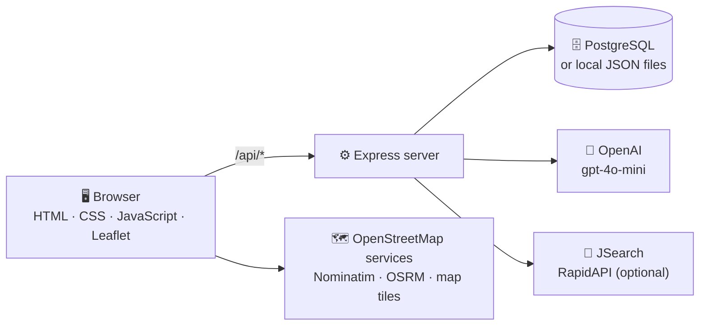

# 🌸 HerSpace

**A women's empowerment platform for Pakistan and South Asia: AI career guidance, job matching, a community safety map, and a wellbeing chatbot in one mobile-first web app.**


---

## ✨ What is this?

Women in Pakistan and South Asia often face several problems at once: finding jobs that fit them, getting around safely, and finding support for health and wellbeing. HerSpace brings these into one app:

| Problem | How HerSpace helps |
|---|---|
| 💼 **Finding the right job** | Upload your CV and get real job listings ranked by how well they match it |
| 🚶 **Moving around safely** | A community map of reported unsafe spots, with route warnings |
| 🧠 **Health and wellbeing support** | A chatbot with Career, Health, and Wellbeing modes, plus a cycle tracker |
| 🤝 **Having someone to learn from** | Mentor profiles (demo data for now, see below) |

> ⚠️ **Prototype notice:** HerSpace is an early prototype, not a production service. Some content is AI-generated or seeded for demonstration (see [Limitations](#-testing-and-limitations)). The chatbot is not a doctor or therapist.

---

## 🎯 Key features

| | Feature | What it does |
|---|---|---|
| 🔐 | **Accounts** | Sign up with name, city, age, and optional CV. Cookie-based login sessions (30 days) |
| 📄 | **CV upload and parsing** | Accepts PDF or Word files (max 5 MB), extracts the text, and uses it to personalize the app |
| 💼 | **Job matching** | Searches real listings via JSearch (RapidAPI) using a query derived from your CV, then scores each listing 0 to 100 against your CV and keeps the relevant ones |
| 🤖 | **C.A.R.E. chatbot** | GPT-4o-mini assistant with three modes: **Career**, **Health**, and **Wellbeing**. It knows your name, city, and CV excerpt |
| 🗺️ | **Safe map** | Leaflet map of community reports in your city shown as danger zones |
| 📝 | **AI-moderated reports** | Submitted safety reports are checked by an AI moderator and rewritten as one neutral sentence before being saved |
| 🧭 | **Routes and trips** | Search a destination, get a route, see a warning if it crosses reported zones, and track the trip with GPS (or a simulation if GPS is unavailable) |
| 🩸 | **Cycle tracker** | Save your last period date and cycle length to see cycle stats |
| 🤝 | **Mentors** | Browse mentor profiles by industry and expertise |
| 👤 | **Profile** | Update phone number, profile picture, and CV |

### 🔒 Privacy by design

- The OpenAI key stays on the server. The browser never sees it; all AI calls go through the Express API.
- Passwords are hashed with bcrypt and session cookies are `httpOnly`.

---

## 🔁 How it works



1. 🔐 You sign up; the server stores your profile and, if you upload a CV, extracts its text.
2. 💼 For job matching, the server asks GPT for a short search query from your CV, fetches listings from JSearch, then asks GPT to score and filter them.
3. 💬 Each chat message is sent with a mode-specific system prompt plus your profile context.
4. 🗺️ The map loads community reports; new reports go through AI moderation before they are saved.

---

## 🧰 Tech stack

| Layer | Tools |
|---|---|
| ⚙️ **Backend** | Node.js 18+, Express 4 |
| 🗄️ **Database** | PostgreSQL (`pg`); automatic JSON-file fallback for local development |
| 🔐 **Auth** | bcryptjs, cookie sessions, JWT (`jsonwebtoken`) for a mobile login endpoint |
| 📄 **File handling** | multer (uploads), pdf-parse (PDF text), mammoth (Word text) |
| 🤖 **AI** | OpenAI Chat Completions (`gpt-4o-mini`) |
| 💼 **Jobs** | JSearch via RapidAPI (optional) |
| 🖥️ **Frontend** | Plain HTML, CSS, and JavaScript, Leaflet 1.9.4 |
| 🗺️ **Map services** | CARTO map tiles, Nominatim (place search), OSRM (routing) |
| ☁️ **Hosting** | Railway (`railway.toml`, health check at `/healthz`) |

### 📁 Project structure

```text
HERspace/
├── server.js          # Express app: auth, chat, jobs, mentors, reports, trips, cycle
├── db.js              # PostgreSQL pool, schema creation, row mappers
├── package.json
├── railway.toml       # Railway deploy config (health check, restart policy)
├── .env.example       # Environment variable template
└── public/
    ├── index.html     # Landing and sign-in screen
    ├── auth.css / auth.js
    ├── app.html       # Main app: Home, Community, Safe Map, ChatBot
    ├── app.js         # Navigation, map, chat, CV upload, cycle tracker
    ├── styles.css     # Design system
    └── videos/intro.mp4
```

### 🗃️ Data model

Tables are created automatically on startup when `DATABASE_URL` is set.

| Table | Purpose |
|---|---|
| `users` | Profile, password hash, city, age, CV filename and extracted text, cycle data |
| `sessions` | Cookie session IDs mapped to users |
| `reports` | Community safety reports (location, category, description, time of day) |
| `trips` | Recent journeys per user (destination, distance, duration, status) |

If the reports table is empty, 8 sample reports around Lahore are inserted.

---

## 🚀 Quick start

**Prerequisites:** Node.js 18 or newer and an [OpenAI API key](https://platform.openai.com/api-keys). PostgreSQL and a RapidAPI key are optional.

**1. 📦 Clone and install**

```bash
git clone https://github.com/munibashami07-oss/HERspace.git
cd HERspace
npm install
```

**2. 🔐 Create your `.env` file**

```bash
# macOS / Linux
cp .env.example .env
```

```powershell
# Windows (PowerShell)
copy .env.example .env
```

Open `.env` and set at least `OPENAI_API_KEY` and `JWT_SECRET` (see [Configuration](#️-configuration)).

**3. ▶️ Start the server**

```bash
npm start
```

**4. 🌐 Open the app:** [http://localhost:3000](http://localhost:3000)

Without `DATABASE_URL`, the app stores data in local JSON files (`data/`) and uploads in `uploads/`. Both folders are gitignored. This mode is for development only.

---

## ⚙️ Configuration

Set these in `.env` (never commit this file).

| Variable | Required | Description |
|---|---|---|
| `OPENAI_API_KEY` | ✅ for AI features | Chat, job ranking, report moderation, and mentors return "Server not configured" without it |
| `JWT_SECRET` | ✅ in production | Signs mobile login tokens. If unset, the server falls back to an insecure built-in development secret, so always set your own |
| `DATABASE_URL` | | PostgreSQL connection string. Railway sets this automatically when you add a Postgres plugin |
| `RAPIDAPI_KEY` | | Enables real job listings via JSearch. Without it, the app generates AI sample companies instead |
| `PORT` | | Server port (default `3000`) |

---

## 🔌 Usage: API overview

All routes are served by the same Express app. "Auth" means a logged-in session cookie is required.

| Area | Endpoint | Auth | Purpose |
|---|---|---|---|
| 🔐 Account | `POST /api/signup` | | Create an account (multipart form, optional `cv` file) |
| | `POST /api/login` | | Log in and set the session cookie |
| | `POST /api/logout` | | Clear the session |
| | `GET /api/me` | | Current user, or `null` |
| 👤 Profile | `POST /api/profile` | ✅ | Update phone, avatar, or CV |
| 📄 CV | `POST /api/cv/upload` | ✅ | Upload a CV (PDF or Word) and extract its text |
| 💬 Chat | `POST /api/chat` | ✅ | Chat with C.A.R.E. (`subTab`: `career`, `health`, `wellbeing`) |
| 💼 Jobs | `GET /api/companies` | ✅ | Job listings matched to your CV (cached for 1 hour) |
| 🤝 Mentors | `GET /api/mentors` | ✅ | Demo mentor profiles for your city |
| 🗺️ Map | `GET /api/reports` | | All community safety reports |
| | `POST /api/reports` | ✅ | Submit a report (AI-moderated) |
| 🧭 Trips | `GET /api/trips`, `POST /api/trips` | ✅ | Recent trips (requires PostgreSQL) |
| 🩸 Cycle | `POST /api/cycle` | ✅ | Save last period date (`YYYY-MM-DD`) and cycle length (20 to 45 days) |
| ❤️ Health check | `GET /healthz` | | Used by Railway |

### Example: log in and chat

```bash
# Log in and save the session cookie
curl -c cookies.txt -X POST http://localhost:3000/api/login \
  -H "Content-Type: application/json" \
  -d '{"email":"you@example.com","password":"your-password"}'

# Ask the career assistant a question
curl -b cookies.txt -X POST http://localhost:3000/api/chat \
  -H "Content-Type: application/json" \
  -d '{"subTab":"career","messages":[{"role":"user","content":"How should I prepare for a software engineering interview?"}]}'
```

The response looks like `{ "reply": "..." }`.

### Example: submit a safety report

```bash
curl -b cookies.txt -X POST http://localhost:3000/api/reports \
  -H "Content-Type: application/json" \
  -d '{"lat":31.518,"lng":74.347,"category":"dimly_lit","description":"Street lights are broken on the back lane.","timeOfDay":"night"}'
```

Valid categories: `dimly_lit`, `crowd`, `harassment`, `infrastructure`, `other`.

---

## ☁️ Deployment

HerSpace is set up for [Railway](https://railway.app):

1. Create a Railway project from this repository.
2. Add the **PostgreSQL** plugin (this sets `DATABASE_URL`).
3. Set `OPENAI_API_KEY`, `JWT_SECRET`, and optionally `RAPIDAPI_KEY` as variables.
4. Deploy. `railway.toml` configures the `/healthz` health check and restart on failure.

---

## 🧪 Testing and limitations

There is no automated test suite yet (`npm test` is not configured). Features are checked manually by running the app locally.

**Please read these before relying on any output:**

- 🧑‍🏫 **Mentors are demo data.** Mentor profiles are generated by AI for the prototype, and the app labels them that way. They are not real people.
- 🗺️ **Sample map data.** An empty reports table is seeded with 8 sample reports around Lahore. Reports from real users are added on top.
- 💼 **Job listings.** With `RAPIDAPI_KEY` set, listings come from JSearch. The star rating and review count on a card can be placeholder values when the source has none, so they are **not verified workplace reviews**. Without the key, the app shows AI-generated sample companies that are not real employers.
- 🤖 **AI can be wrong.** Job match scores, report rewrites, and chat replies come from a language model. The Health and Wellbeing modes give general information only. They are not medical advice, diagnosis, or therapy. In a crisis, contact a professional or a local helpline.
- 🔌 **Data goes to third parties.** To personalize replies, your name, age, city, and an excerpt of your CV text are sent to OpenAI. Place searches and routes go to OpenStreetMap services (Nominatim and OSRM).
- 🧪 **Prototype security.** The app has not had a security audit and has no rate limiting yet. Do not store real sensitive data in a public deployment until the roadmap items below are done.
- 📱 **Mobile token login is partial.** `POST /api/auth/login` returns a JWT, but the app's protected routes currently accept only the cookie session.
- 💾 **Local mode is for development.** The JSON-file fallback and the in-memory caches (jobs, mentors) are not suitable for production.

### 🗺️ Roadmap

> Proposed next steps, not commitments.

| Priority | Item |
|---|---|
| 🔜 Next | Add automated tests for auth, reports, and CV parsing |
| 🔜 Next | Add rate limiting and stricter upload validation |
| 🔜 Next | Store uploaded CVs and avatars privately instead of as public files |
| 🔜 Next | Show real, verified workplace reviews instead of placeholder ratings |
| 💭 Later | Complete token auth for mobile clients |
| 💭 Later | Password reset and email verification |
| 💭 Later | Urdu language support |

---

## 🤝 Contributing

Contributions are welcome, especially around safety, privacy, accessibility, and South Asian language support.

1. 🔎 Check [open issues](https://github.com/munibashami07-oss/HERspace/issues) and [pull requests](https://github.com/munibashami07-oss/HERspace/pulls). For big changes, open an issue first.
2. 🍴 Fork the repo and clone your fork.
3. 🌿 Create a branch from `main`:
   ```bash
   git checkout -b feature/short-description
   ```
4. 🛠️ Keep changes focused and match the existing code style.
5. 🧪 Run the app locally and test the screens you changed. Add automated tests where you can.
6. 💬 Commit with a clear message, e.g. `feat: add urdu language toggle` or `fix: validate report coordinates`.
7. 📤 Open a pull request against `main`. Describe the problem, the fix, and how you tested it. Add screenshots for UI changes.

🔒 Never commit `.env` files, API keys, user data, or uploaded files. Because HerSpace handles sensitive personal data, be especially careful with anything involving CVs, locations, or health information.

---

## ⭐ Support

If HerSpace resonates with you, give the repo a **star** ⭐ and share it with someone it could help.

Made with ❤️ by **[Muniba](https://github.com/munibashami07-oss)**
